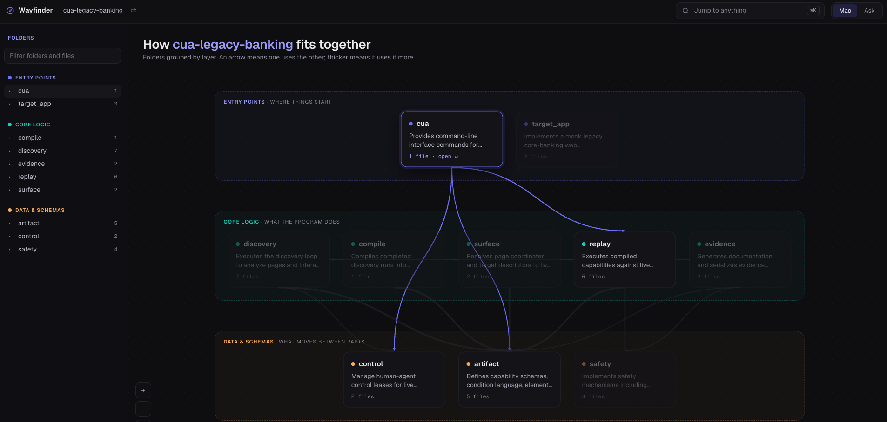
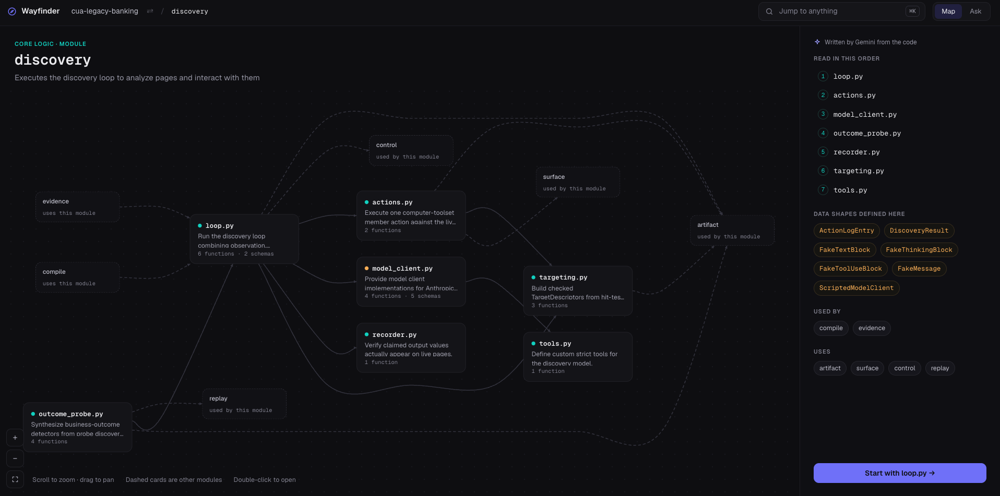
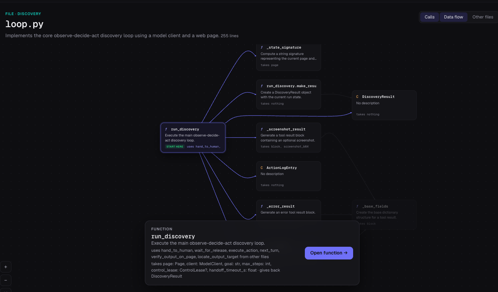
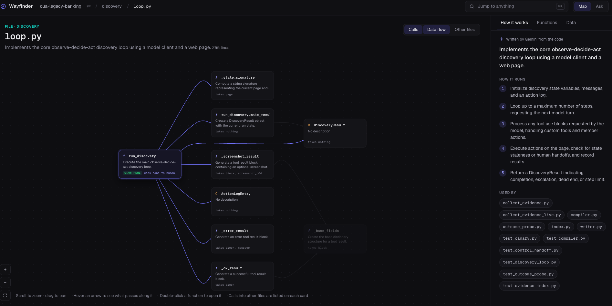
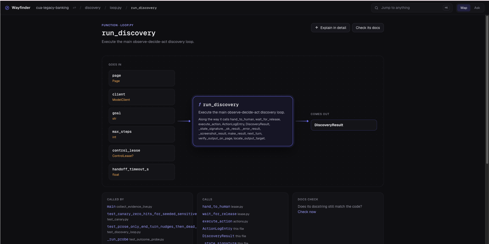

# Wayfinder

**Find your way around unfamiliar Python, JavaScript or TypeScript code.** Point at a
function and see who calls it, what it calls, and what data flows between them - then get
a plain-language explanation of that function, or of the whole chain of calls between two
of them.

> **Status:** early stage (`0.1.0`). It works end to end and is used through an MCP server
> or an HTTP API. There is no automated test suite yet - see [Limitations](#limitations).

The call graph and the data flow come from real static analysis - pyright for Python,
`typescript-language-server` for JS/TS - not from a model guessing. Models only *explain*
what the analysis already established, and they are optional.

```text
fetch_user --[user: User]--> process     # the value one call returns, passed into the next
```



## Contents

- [Why Wayfinder](#why-wayfinder)
- [Features](#features)
- [Quick start](#quick-start)
- [Example](#example)
- [Installation](#installation)
- [Usage](#usage)
  - [MCP server](#mcp-server)
  - [HTTP API](#http-api)
- [Configuration](#configuration)
- [Privacy and security](#privacy-and-security)
- [How it works](#how-it-works)
- [Project structure](#project-structure)
- [Development](#development)
- [Troubleshooting](#troubleshooting)
- [Limitations](#limitations)
- [Roadmap](#roadmap)
- [License](#license)
- [Acknowledgements](#acknowledgements)

## Why Wayfinder

Starting on a codebase you didn't write - a new job, an interview in a language you don't
know - the hard part isn't reading any one function. It's knowing where to start and how
data moves between functions. Wayfinder answers exactly that: pick a function and follow it
outward, with the types of what is passed along each call.

Generic "explain this code" tools guess at structure. Wayfinder builds the structure from
the language server first, so the graph is exact and every explanation is grounded in it.

## Features

- **Call graph.** Callers and callees of any function or method, up to 5 hops out, with the
  arguments and return type of every call.
- **Data flow.** Which call's result is stored and later passed to which other call.
- **Explain a function.** A short plain-language summary written from the real source and
  the analyzed call details, saying so when something isn't visible rather than guessing.
- **Explain a call path.** How one function reaches another (`handler -> save -> db_write`),
  told as one walkthrough of the data moving along the chain.
- **Check docs for drift.** Finds docstrings that no longer match the code: a documented
  parameter that doesn't exist, a documented return value that never happens, stale
  `Raises` lists. Static findings need no model; a model can add a review of fuzzier claims.
- **Works offline.** Analysis runs locally. Only the explanations and the model half of the
  drift check use a hosted model, and an offline switch turns that off entirely.
- **Ask in plain English.** `POST /ask` takes a question like *"who calls `fetch_user` and what do
  they pass it?"* and lets Claude, running on your own Claude Code login, choose which of the
  tools above to call and answer from what they return.
- **Runtime trace (Flow-Tracer).** Optionally runs a file or one function and records which
  functions really called which, then compares that with the static graph: calls static
  analysis missed (callbacks, dispatch tables) and calls that exist in the code but were never
  reached. It executes the repository's code, so it is off unless you enable it.
- **Repo map.** Every Python, JS/TS file in a repository and which files import which, with a
  plain-language summary built from the analysis alone, so it needs no model.
- **File view and file explanation.** One file drawn as its functions and the calls between them
  (and out to other files of the repo), with the data flowing along those calls. `POST /explain-file`
  turns that structure plus the file's source into a walkthrough of how the file works.
- **Web UI.** An interactive app (React + Vite) with three modes: *Explore* (the repo map, then a
  file's graph; click nodes to explain them, check their docs or explain the path between two),
  *Runtime trace* and *Ask*.
- **Two interfaces.** An MCP server (so Claude Code and other agents can call it as tools)
  and an HTTP API.

## Quick start

```bash
npm install -g pyright            # provides pyright-langserver
git clone https://github.com/abedreshivakumar/wayfinder.git && cd wayfinder
uv sync
claude mcp add wayfinder -- uv run --directory "$PWD" python -m wayfinder.mcp_server
```

Then ask your agent something like *"use wayfinder to show who calls `fetch_user` in
`app.py` of `/path/to/repo`"*.

## Example

Call graph for `handle_login` in the bundled sample repo
(`tests/fixtures/sample_repo/app.py`), trimmed. Real node ids are long file URIs; they are
shown here as function names for readability.

```json
{
  "root_id": "file:///path/to/repo/app.py#14:4",
  "edges": [
    { "from_id": "handle_login", "to_id": "fetch_user" },
    { "from_id": "handle_login", "to_id": "process" }
  ],
  "call_labels": [
    { "caller_id": "handle_login", "callee_id": "fetch_user", "line": 16,
      "args": [{ "text": "uid", "type": "str" }],
      "returns_var": "user", "returns_type": "User" },
    { "caller_id": "handle_login", "callee_id": "process", "line": 17,
      "args": [{ "text": "user", "type": "User" }],
      "returns_var": null, "returns_type": "None" }
  ],
  "flow_links": [
    { "caller": "handle_login", "producer": "fetch_user", "var": "user",
      "type": "User", "consumer": "process" }
  ]
}
```

`flow_links` is the point: the `User` that `fetch_user` returns is the same value `process`
receives. Documentation drift, for a function whose docstring has gone stale:

```json
{
  "name": "send_report",
  "findings": [
    { "severity": "high",   "kind": "param-not-in-signature", "line": 2,
      "message": "the docstring documents parameter 'timeout', but the function has no such parameter (its parameters are: user, retries)" },
    { "severity": "medium", "kind": "returns-without-value", "line": 2,
      "message": "the docstring describes a return value, but the function never returns one" },
    { "severity": "low",    "kind": "param-undocumented", "line": 2,
      "message": "parameter 'retries' is missing from the docstring's parameter list" }
  ],
  "model_review": "skipped: no Gemini API key found ..."
}
```

## Installation

### Requirements

- Python 3.12 or newer
- [uv](https://docs.astral.sh/uv/) for dependency management
- Node.js, for `pyright` (`npm install -g pyright`; `pyright-langserver` must be on your `PATH`)
  and for analyzing JS/TS repos (`typescript-language-server`, installed locally - see below)
- Only for `/ask`: [Claude Code](https://claude.com/claude-code) installed and logged in. No API key is
  needed; the Claude Agent SDK uses that login

### Install

```bash
uv sync
cd src/wayfinder/languages/javascript/tools && npm install && cd -   # only needed to analyze JS/TS repos
```

The analyzed project's own dependencies should be installed in the Python environment on your
`PATH` if you want their types resolved - see [Limitations](#limitations).

## Usage

Every request names a function by **repo root** (absolute path), **file** (relative to the
root) and **symbol** (`fetch_user`, or `Class.method` when the plain name is ambiguous).
You can also give an exact `line` and `col` instead of a symbol.

### MCP server

Run over stdio:

```bash
uv run --directory /path/to/wayfinder python -m wayfinder.mcp_server
```

Register it with Claude Code:

```bash
claude mcp add wayfinder -- uv run --directory /path/to/wayfinder python -m wayfinder.mcp_server
```

| Tool | Arguments | Returns |
|---|---|---|
| `who_calls` | `repo`, `file`, `symbol`, `hops=1` | Callers of the function |
| `what_does_this_call` | `repo`, `file`, `symbol`, `hops=1` | Everything the function calls |
| `trace_data_flow` | `repo`, `file`, `symbol`, `hops=1` | Both directions plus data-flow links |
| `explain_function` | `repo`, `file`, `symbol` | Plain-language explanation |
| `explain_call_path` | `repo`, `from_file`, `from_symbol`, `to_file`, `to_symbol`, `hops=3` | Walkthrough of the calls between two functions |
| `check_docs_drift` | `repo`, `file`, `symbol` | Documentation-versus-code findings |
| `trace_runtime_calls` | `repo`, `file`, `function?`, `args?`, `kwargs?` | Calls that really happened, compared with the static graph. Refuses unless `WAYFINDER_ALLOW_TRACE` is set |

All tools are read-only with respect to your code. Errors come back with actionable messages
(for example, an ambiguous name lists the candidates so the caller can retry).

### Web UI

```bash
cd web && npm install && npm run build      # once
uv run uvicorn wayfinder.api.main:app       # the server now also serves the UI at http://localhost:8000
```

For UI development run `npm run dev` in `web/` (port 5173, forwards `/api` to the server on 8000).
Runtime tracing additionally needs `WAYFINDER_ALLOW_TRACE=1`.

#### Screenshots

| | |
|---|---|
|  Module view: a folder's files, with a reading order and what each one is for |  File view: hover an arrow to see what it passes, without cluttering the graph |
|  The side panel: a numbered walkthrough of how the file works, written from the real call graph |  Function view: inputs → what it does → output, with real types - not guessed |

### HTTP API

```bash
uv run uvicorn wayfinder.api.main:app          # http://localhost:8000, docs at /docs
curl 'http://localhost:8000/graph?repo=/path/to/repo&file=app.py&symbol=handle_login&hops=2'
```

| Endpoint | Request | Response |
|---|---|---|
| `GET /graph` | query: `repo`, `file`, `symbol` **or** `line`+`col`, `hops`, `direction` (`incoming`/`outgoing`) | `root_id`, `nodes`, `edges`, `call_labels`, `flow_links` |
| `POST /narrate` | `{"node_id"}` | `node_id`, `text`, `cached` |
| `POST /explain-path` | `{"from_id", "to_id", "max_hops"}` | `node_ids`, `names`, `text`, `cached` |
| `POST /check-drift` | `{"node_id"}` | `node_id`, `name`, `findings`, `model_review` |
| `POST /ask` | `{"repo", "question"}` | `text`, `tools_used`, `turns` |
| `POST /trace` | `{"repo", "file", "function"?, "args"?, "kwargs"?}` | `nodes`, `edges` (each with a `status`), `error`, `returned`, `output` |
| `POST /explain-file` | `{"repo", "file"}` | Plain-language walkthrough of one file |
| `GET /files` | query: `repo` | `files` (files of a supported language, relative to the repo) |
| `GET /symbols` | query: `repo`, `file` | `symbols` (callable names with positions) |
| `GET /repo-map` | query: `repo` | `files`, `edges` (which file imports which), `truncated` |
| `GET /file-graph` | query: `repo`, `file` | The file's functions, the calls between them and the data flow along them |

`/ask` is HTTP-only on purpose: exposing it as an MCP tool would be an agent asking an agent.
Node ids come from a `GET /graph` response. Lines and columns are 1-indexed.

#### Status codes

| Code | Meaning |
|---|---|
| `400` | Bad request (missing/conflicting arguments, hops out of range, file outside the repo) |
| `403` | Refused by a guardrail (offline mode, or the repo isn't allowed to be sent to a model) |
| `404` | Symbol, node, or call path not found |
| `409` | Ambiguous symbol; the body lists the matches |
| `422` | Malformed request |
| `429` | Too many model calls; see the `Retry-After` header |
| `502` | The model provider failed |
| `503` | Not configured (for example no API key) |

## Configuration

Each setting is read from the environment first, then from `~/.wayfinder/.env`, then a
default. Put keys in that file: it lives outside any repository, so it can't be committed
by accident (and this repo's `.gitignore` excludes `.env` and `*.db` regardless).

| Variable | Default | Purpose |
|---|---|---|
| `GEMINI_API_KEY` | none | Enables the explanation agents. Without it, analysis and static drift checks still work |
| `WAYFINDER_MODEL` | `gemini-3.5-flash-lite` | Which Gemini model to use |
| `WAYFINDER_DB` | `~/.wayfinder/graph.db` | Where analysis results and cached explanations are stored |
| `WAYFINDER_OFFLINE` | off | `1`/`true`/`yes`/`on` blocks every call to a hosted model |
| `WAYFINDER_LLM_ALLOWED_REPOS` | none | Repos whose source may be sent to a hosted model, separated by `:` |
| `WAYFINDER_ALLOW_TRACE` | off | `1`/`true`/`yes`/`on` lets `POST /trace` and the MCP `trace_runtime_calls` tool run the repo's code. Not a sandbox: enable only for code you trust |

Example `~/.wayfinder/.env`:

```bash
GEMINI_API_KEY=your-key-here
WAYFINDER_LLM_ALLOWED_REPOS=/path/to/my/project
```

## Privacy and security

Explaining code with a hosted model means sending that code to a third party. The defaults
are deliberately strict:

| Guardrail | Behavior |
|---|---|
| **Default-deny allowlist** | Nothing is sent to a hosted model unless its repo is in `WAYFINDER_LLM_ALLOWED_REPOS`. Only allow code you are permitted to share |
| **Offline switch** | `WAYFINDER_OFFLINE=1` refuses every hosted-model call, whatever else is configured. Analysis and cached explanations keep working |
| **Secret redaction** | Cloud keys, tokens, JWTs, private keys, URL passwords and secret-looking assignments are blanked out of every prompt and every model reply. Literal values are also stripped from type text, so a constant can't leak through its type |
| **Untrusted source** | Repository code is fenced so it cannot close its own block, and the model is instructed never to follow instructions found inside it |
| **Limits** | Hops are capped at 5, prompts at 30,000 characters, hosted-model calls at 20 per minute. Cached explanations cost nothing |
| **Ask (`/ask`)** | The question and everything the tools find go to Anthropic through your Claude Code login, so it is refused in offline mode and unless the repo is allowlisted. The agent gets **no built-in tools** (no shell, no file access), none of your personal Claude settings or hooks, and runs in an empty temporary directory. Its tools are bound to the one repo you named, take no repo argument, and return compact text with relative paths, secrets redacted and size capped. At most 8 turns per question, and each question counts against the rate limit |
| **Path sandbox** | A request can only read files of a supported language inside the repo it names; `../` and symlinks that leave the repo are refused |
| **Withheld source on chains** | In a call-path explanation, source from files outside your allowlist is withheld from the prompt |

**What is stored locally.** `~/.wayfinder/graph.db` holds function names, file paths, call
details and cached explanations - all derived from your code. Treat it with the same care as
the code itself. Delete it any time; it is rebuilt on demand.

**Recommended while evaluating on code you don't own:** set `WAYFINDER_OFFLINE=1`. Analysis
and the static drift checks are unaffected and nothing leaves your machine.

## How it works

```text
request ─▶ services ─▶ analysis ─▶ a language server (LSP) ── call hierarchy, types
              │            └─ outline + imports ──────────── arguments, assignments, schemas
              ├─▶ storage (SQLite) ── graph, labels, cached explanations
              └─▶ agents ─▶ guardrails ─▶ model ───── explanations (optional)
```

A `Language` registry (`src/wayfinder/languages/`) picks which implementation runs per file
extension - everything above it (storage, agents, guardrails, the API, the UI) is identical
either way:

| | Python | JavaScript/TypeScript |
| --- | --- | --- |
| Language server | pyright | `typescript-language-server` |
| Outline + imports | Python's own `ast` module | the TypeScript compiler API, via a small Node subprocess |

1. **The language server answers "who calls this / what does this call"** over the Language
   Server Protocol - exact, compiler-grade answers instead of guesses.
2. **The outline/imports pass** finds each call's arguments and where its result goes; the
   language server's hover supplies the types. Together they produce the data-flow labels.
3. **Results are stored in SQLite**, so repeat questions are instant and don't need pyright.
   Re-analysing a function replaces what was stored for it, so calls removed from the code
   disappear from the graph.
4. **Agents turn the analyzed facts into explanations**, behind the guardrails above.
   Deterministic checks come first; a model is only used for judgment.

## Project structure

```text
src/wayfinder/
  core/        config.py (all settings) · errors.py (one error hierarchy)
  domain/      plain data types: graph, labels, results
  lsp/         pyright client: message framing, handshake, symbol lookup
  analysis/    call graph, path search, source extraction, imports, docstrings,
               dataflow/ · tracing/ (runtime trace and reconciliation with the static graph)
  storage/     SQLite schema, row mapping, repository
  agents/      llm/ (interface, Gemini, guarded wrapper) · prompts/ · narrator,
               path_explainer, drift_checker, file_explainer, orchestrator, claude_code_runner
  guardrails/  inputs · secrets · llm_input · llm_output · egress · rate_limit
  services/    analysis · explanation · drift · overview · tracing · orchestration ·
               driver pool · model access
  api/         FastAPI app, routers, error handlers
  mcp_server/  MCP server and tools
web/src/       React + Vite UI (repo map, file view, runtime trace, ask)
tests/fixtures/sample_repo/   a tiny known-answer repo for manual checks
artifacts/                    early design notes (see Status below)
```

## Development

```bash
uv sync                                   # install
uv run uvicorn wayfinder.api.main:app --reload
```

### Conventions

- **Dependencies point inward.** `api`/`mcp_server` call `services`; services use `agents`,
  `analysis` and `storage`; everything rests on `domain` and `core`. `guardrails` sits below
  `agents` and `services`. Nothing imports upward.
- **One place per concern.** Settings live in `core/config.py`, deliberate errors in
  `core/errors.py` (each front door translates them once: `api/error_handlers.py`,
  `mcp_server/errors.py`), prompts in `agents/prompts/`, SQL in `storage/`.
- **Deterministic first.** Facts the code states exactly are computed, not asked of a model.
- **Adding a capability:** write the logic in a service, then expose it as a route in
  `api/routers/` and a tool in `mcp_server/tools.py`. Both stay thin.
- **Line and column numbers are 1-indexed everywhere a person sees them.** Only the wire
  format to pyright is 0-indexed, and the conversion lives in `lsp/position.py`.

**Manual check on the sample repo** - `tests/fixtures/sample_repo/app.py` has a known call
graph (`handle_login` calls `fetch_user` and `process`; `fetch_user` returns a `User` that
`process` receives), so the expected output above is easy to verify.

## Troubleshooting

| Symptom | Cause and fix |
|---|---|
| `pyright-langserver: command not found` | Install it: `npm install -g pyright`, and make sure it is on `PATH` |
| `no Gemini API key found` | Set `GEMINI_API_KEY` in the environment or `~/.wayfinder/.env`. Analysis works without one |
| `offline mode is on` | `WAYFINDER_OFFLINE` is set. Remove it (or set it to `0`) to allow hosted-model calls |
| `... isn't allowed to be sent to an external model` | Add the repo to `WAYFINDER_LLM_ALLOWED_REPOS`, only if you may share that code |
| `'name' matches N symbols. Use a qualified name` | Repeat with `Class.method`, or use `line`+`col` |
| Types show as unknown / a call is missing | pyright can't see that package, or the call is dynamic. See [Limitations](#limitations) |
| First request to a repo is slow | pyright is starting and indexing; later requests reuse the running process |
| `could not run Claude Code` | `/ask` needs Claude Code installed and logged in. Run `claude` once in a terminal to log in |
| `Claude used all 8 turns without finishing` | The question needed too many steps. Ask something narrower, or name the function and file |
| Stale results | Analysis re-reads changed files automatically. To start clean, delete `~/.wayfinder/graph.db` |

## Limitations

- **Static analysis only.** Dynamic dispatch, monkey-patching and callbacks registered at
  runtime are invisible to pyright, so those calls are missing from the graph.
- **Python, JavaScript and TypeScript.** The call graph, data flow, repo map and schema
  detection work for both; **Flow-Tracer (runtime tracing) is Python only** - there's no
  JS/TS equivalent yet.
- **Dependency resolution.** pyright resolves third-party Python packages from the Python on
  your `PATH`, not from the analyzed repo's own environment, so types from unresolved
  packages show as unknown and library internals can appear as nodes. For JS/TS, a bare
  package import (`react`, `lodash`) is treated as external and never resolved to a file at
  all - only relative imports and `tsconfig.json` path aliases are followed.
- Overloaded builtins such as `print` appear as several nodes, one per overload.
- **Drift checks** cover functions and methods, not classes. A `Raises` entry that is never
  raised *directly* is reported as low severity, since the exception may come from a callee.
- **Single user, local.** There is no authentication; it is meant to run on your own machine.
- **The web UI has been built and type-checked but not clicked through in a browser yet**, and the
  runtime trace is verified only on the small sample repo. It records calls inside the repo
  under the interpreter Wayfinder runs on, so a repo needing its own dependencies may fail to
  run; the failure is reported in the trace's `error`.
- **`/ask` has not yet been run against a live Claude session.** It is verified against a scripted stand-in
  for the model, including exactly what options are handed to Claude Code, but not end to end.
- **`/ask` uses your own Claude Code login,** so it is meant for personal use. If you distribute this, each
  person should use their own credentials; check Anthropic's current terms for the Agent SDK.
- **No automated tests yet.** The repo map lists at most 2,000 files and a file view draws at most
  60 functions; the response says when it was cut short.
- `pyright` reports a few false positives on the MCP SDK's `readOnlyHint`/`destructiveHint` arguments.

## Roadmap

Built: call graph, data flow, MCP and HTTP interfaces, Narrator, Path-Explainer,
Drift-Checker, File-Explainer, Orchestrator (`/ask`), Flow-Tracer, repo map and file view,
web UI, guardrails, JavaScript/TypeScript support (`src/wayfinder/languages/`) alongside
Python - proof that the LSP-based design generalizes to a new language server without
touching the engine above it.

Not yet built:

- A runtime tracer (Flow-Tracer) for JS/TS - it's Python only today.
- A fourth language, to prove the `Language` seam again on something that isn't two
  LSP-based static-typed-ish languages.

`artifacts/` holds early design notes, written when the project was still called Donkeymind.
They predate a restructure of the code, so names and file paths in them are out of date.

## License

No license has been chosen yet. Until one is added, all rights are reserved.

## Acknowledgements

Built on [pyright](https://github.com/microsoft/pyright) and the Language Server Protocol,
[FastAPI](https://fastapi.tiangolo.com/), the [Model Context Protocol](https://modelcontextprotocol.io/)
Python SDK, [uv](https://docs.astral.sh/uv/), and SQLite.
